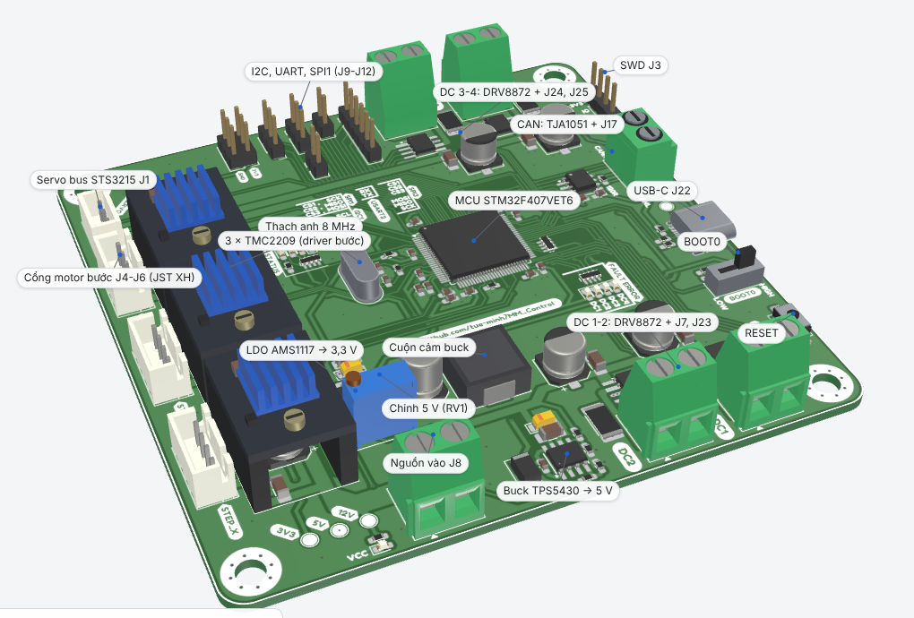
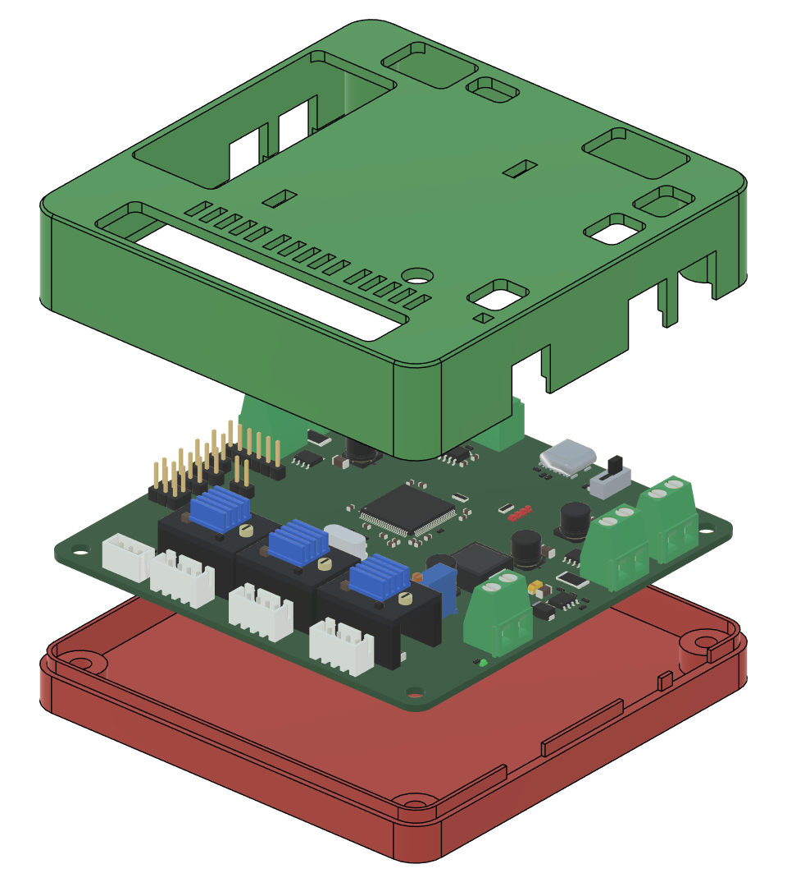

# MM_Control

Board điều khiển chuyển động dùng STM32F407VET6, 100 × 100 mm, 2 lớp. Một board gồm 4 kênh động cơ DC (DRV8872), 3 socket driver bước TMC2209, cổng bus servo STS3215, USB-C (CDC), CAN và các header SPI, I2C, UART.

Repo gồm hồ sơ thiết kế (KiCad, Gerber, BOM), firmware, thư viện Python, vỏ in 3D và tài liệu hướng dẫn đặt mạch, mua linh kiện, hàn, kiểm tra, ứng dụng. Tác giả thiết kế: tue-minh. Chỉnh sửa và bổ sung: giang-hoangnguyen.



## Trạng thái

Nội dung đọc từ file thiết kế, mã firmware và datasheet. **Chưa có bước nào được chạy trên board thật.**

| Chức năng | Phần cứng | Firmware (bản 12/10/2026) | Kết luận |
|---|---|---|---|
| 4 động cơ DC | Có | Có, điều khiển hở qua USB | Dùng được |
| Servo STS3215 | Có (J1) | Có | Dùng được, VM phải đúng điện áp servo |
| 3 động cơ bước | Có (3 × TMC2209) | Mã đọc được chỉ đặt chân DIR, không thấy phát xung STEP | Cần bổ sung firmware, cần đo PE9 để xác nhận |
| CNC 3 trục | 3 driver, không có cổng endstop | Không có nội suy, không có G-code | Cần phát triển |
| CNC 4–5 trục | Không đủ driver | Không | Không hỗ trợ |
| CAN, I2C, SPI, cảm biến | Có chân nối | Lệnh khai báo, chưa triển khai | Cần tự bổ sung |

## Bắt đầu

1. Đọc [docs/MM_Control_Hướng dẫn.pdf](docs/MM_Control_H%C6%B0%E1%BB%9Bng%20d%E1%BA%ABn.pdf), mục 1 và mục 2 (giới hạn điện).
2. Xem nhanh bằng [docs/MM_Control_Hướng dẫn.pptx](docs/MM_Control_H%C6%B0%E1%BB%9Bng%20d%E1%BA%ABn.pptx).
3. Đặt PCB bằng [hardware/MM_Control_gerber.zip](hardware/MM_Control_gerber.zip): 2 lớp, 100 × 100 mm, 1,6 mm.
4. Mua linh kiện theo [hardware/BOM_MM_Control.csv](hardware/BOM_MM_Control.csv), thêm 3 module TMC2209, động cơ, nguồn, ST-Link, cáp USB-C dữ liệu.
5. Hàn theo 4 giai đoạn (nguồn 5 V, 3,3 V, MCU và USB, driver). Chỉnh RV1 cho TP3 = 5,0 V **trước khi** gắn linh kiện 5 V.
6. Nạp firmware (`firmware/build/Debug/MM_Control.bin` tại 0x08000000) bằng ST-Link qua J3.
7. Test từng khối bằng ví dụ Python trong `firmware/python/examples`.

## Giới hạn điện cần nhớ

| Mục | Giá trị | Cơ sở |
|---|---|---|
| VM dùng được | 6,5–28 V | DRV8872 ≥ 6,5 V, TMC2209 ≤ 28 V (datasheet) |
| Dòng chop mỗi kênh DC | khoảng 1,75 A | 0,35 V / 0,2 Ω (datasheet DRV8872, tự tính) |
| TMC2209 | 2 A RMS mỗi cuộn | datasheet |
| Buck 5 V | 3 A | datasheet TPS5430 |
| Servo STS3215 | bản 7,4 V: 4–7,4 V; có bản 12 V | datasheet Feetech; dùng chung rail VM |

Board không có mạch chống ngược cực trên VM. USB-C không cấp nguồn cho board.

## Cấu trúc thư mục

```
docs/        Hướng dẫn chi tiết (PDF, Word), slide hướng dẫn
hardware/    Gerber, BOM, schematic PDF, dự án KiCad 9
firmware/    Mã nguồn STM32 (CMake), thư viện Python, file .bin dựng sẵn
enclosure/   Vỏ in 3D: STL (hướng in), file Fusion, script dựng vỏ
images/      Ảnh dùng trong tài liệu
```

## Vỏ in 3D

Vỏ hai mảnh, kẹp board bằng 4 vít M4 × 12 qua lỗ góc, 4 insert M4 trong trụ nắp. In PLA, không cần support. Chưa in thử: khe lắp 0,3 mm, độ sâu lỗ insert và cửa sổ cần chỉnh theo máy in. Script `enclosure/scripts/build_enclosure_fusion.py` dựng lại vỏ trong Autodesk Fusion từ file `enclosure/fusion/MM_Control_Board_v7.f3d`.



## Nguồn và giấy phép

- Hồ sơ thiết kế, firmware và thư viện Python do tue-minh thiết kế. Repo này đã được trao đổi với tác giả.
- Datasheet: TI DRV8872, TPS5430; Trinamic TMC2209; Feetech STS3215 (liên kết trong tài liệu chi tiết, mục 9).
- Repo không kèm file LICENSE.
